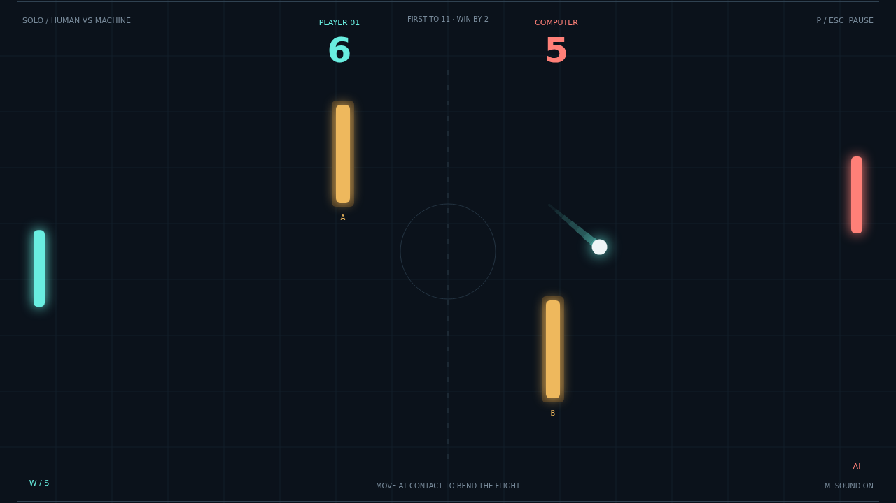

# Carom

Two paddles. Two obstacles. One more angle than your opponent expected. Carom is a quick, luminous paddle duel on a dark court, with a computer opponent for solo sessions and a local Versus mode for settling scores across one keyboard.

The opening serve gives you a moment to find your position. Then the rally gathers pace: each paddle strike makes the ball faster, every wall opens a new route, and the amber bars in the middle turn a clear shot into a bank-shot puzzle.

Your paddle's movement at contact puts spin on the ball. Slide upward to curl a shot up, or drive downward to bend its path toward a gap. Watch the glowing trail trace the curve, and learn to see an obstacle as a chance to change the angle.

First to eleven wins, but you need a two-point lead. A tied match keeps going until one player creates the opening. Play a patient return, take a sharp bank, or put everything into a spinning strike at match point.

